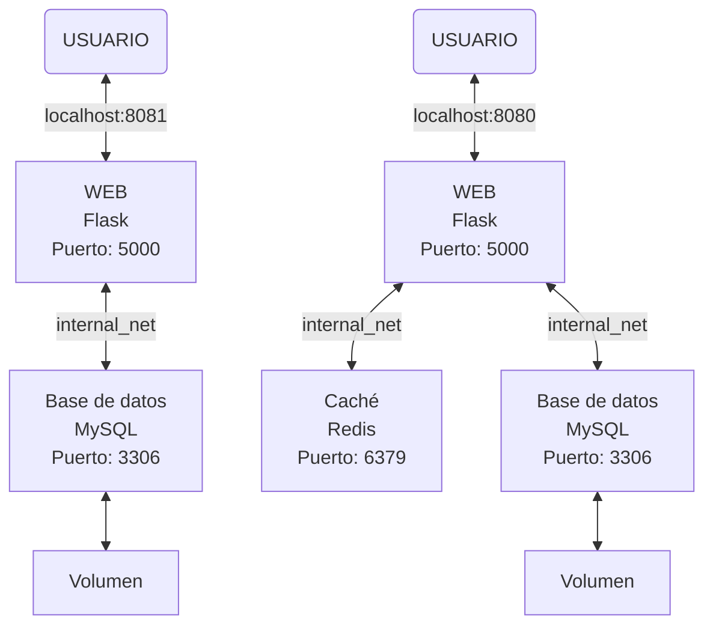
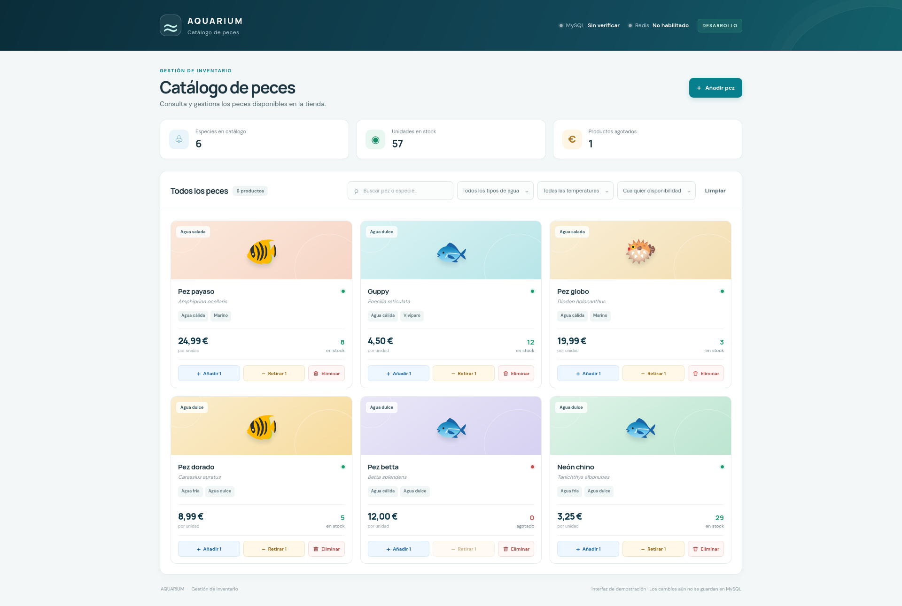
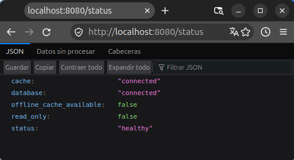
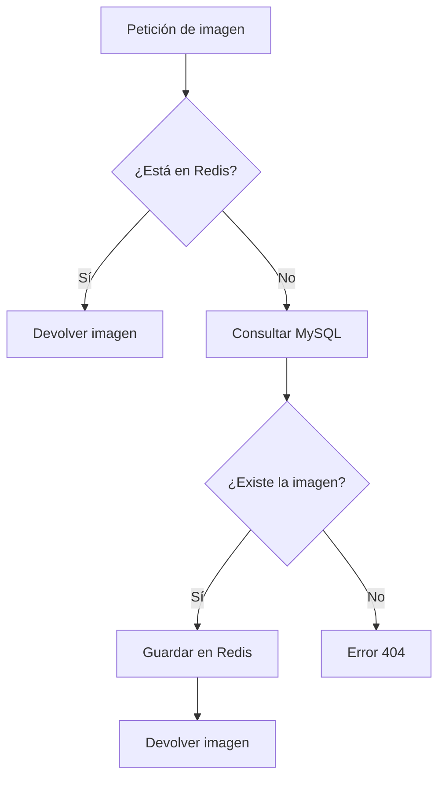

# Práctica 1 🐳 - Despliegue de aplicaciones multi-entorno

## Introducción

El objetivo de esta práctica es diseñar y desplegar una aplicación multicontenedor utilizando Docker Compose, simulando un entorno de despliegue real.

La arquitectura estará compuesta por una aplicación web, una base de datos y un servicio de caché, este último presente únicamente en el entorno de producción. Se configurarán dos entornos independientes, desarrollo (`dev`) y producción (`prod`), adaptando los servicios y sus configuraciones a las necesidades de cada uno.

A lo largo de la práctica se trabajarán conceptos fundamentales del ecosistema Docker, como la orquestación de contenedores, la gestión de variables de entorno, la persistencia de datos mediante volúmenes, la comunicación entre servicios a través de redes internas, las comprobaciones de estado (*healthchecks*) y la automatización de tareas mediante un *Makefile*.

El propósito final es obtener una infraestructura organizada, reproducible y fácil de gestionar, mediante el despliegue de aplicaciones con Docker Compose.

## Preparación para el proyecto

Antes de adentrarnos a generar archivos y documentos para la práctica, vamos a organizar qué utilizaremos. 

Seguiremos la siguiente estructura:

| Tecnología | Función |
| :--- | ---: |
| Python + Flask | Aplicación web y lógica del servidor |
| HTML, CSS y JavaScript | Interfaz de la página web |
| MySQL | Base de datos |
| Redis | Caché |
| Docker Compose | Orquestar los contenedores de la aplicación y los servicios|
| Makefile | Automatizar las operaciones habituales |

La organización de las carpetas quedará tal que así:

```
Practica1/
├── app/
│   ├── static/
|   |   ├── app.js
|   |   └── style.css
|   ├── templates/
│   |   └── index.html
│   ├── Dockerfile
│   ├── app.py
│   └── requirements.txt
├── db/
│   ├── images/
|   |   └── *.jpg   ;All .jpg images to have some fish data in sql database
│   └── init.sql
├── exampleImages/
|   └── *.jpg       ;All fish images to insert into the db through website to prove it's functioning
├── imagesP1/
|   └── *.jpg       ;All screenshots for the README.md
├── docker-compose.dev.yml
├── docker-compose.prod.yml
├── .env.dev
├── .env.prod
├── .gitignore
├── Makefile
└── README.md
```

Para el diseño de los entornos quedaría de la siguiente manera, siendo el esquema de la izquierda el entorno `dev` y el de la derecha el entorno `prod`:



Una pequeña observación a cerca de los dos entornos es que tanto la WEB como la Base de Datos tienen el mismo puerto en `prod` y en `dev`. Entonces, no habrán conflictos? No, ya que el echo de compartir el mismo número de puerto no significa que compartan la misma base de datos. No hay ningún conflicto porque <u>cada entorno tiene su propia red y sus propios servicios</u>, haciendo que sean distintos el uno del otro.

## Diseño de la página web

Para esta práctica se ha decidido desarrollar **Aquarium**, una aplicación web para gestionar el inventario de peces de una tienda de animales especializada en acuariofilia.

La aplicación contará con una interfaz sencilla e intuitiva que permitirá consultar el catálogo, filtrar los peces disponibles y registrar nuevos ejemplares en el inventario. No se implementará un sistema de compras, ya que el objetivo principal es gestionar el *stock* y trabajar con la arquitectura de servicios propuesta en la práctica.

### Funcionalidades principales

#### 1 - Consulta del catálogo

La página principal mostrará los peces registrados mediante tarjetas informativas, incluyendo los siguientes datos:

- Nombre común y especie
- Tipo de agua y temperatura
- Precio
- Unidades disponibles en *stock*
- Una imagen

Además, se mostrará el número de especies en el catálogo, el número total de unidades en *stock* y el número de especies agotadas.

#### 2 - Filtrado de peces

Se podrán combinar diferentes filtros para localizar fácilmente los peces que cumplan los criterios seleccionados:

| Filtro | Opciones |
|---|---|
| Búsqueda | Escritura manual del nombre común o especie |
| Tipo de agua | Dulce o salada |
| Temperatura | Fría o cálida |
| Disponibilidad | En *stock* o agotado |

Por ejemplo, se podrán consultar únicamente los peces de agua dulce que vivan en aguas cálidas, que estén disponibles en *stock* y contengan en el nombre común o de la especie los caracteres 'an' en ese orden y en cualquier parte del nombre.

#### 3 - Registro de nuevos peces

La aplicación dispondrá de un formulario emergente (*pop-up*) para añadir nuevos ejemplares al inventario.

El formulario permitirá introducir la siguiente información:

- Nombre común
- Especie
- Tipo de agua
- Temperatura
- Precio
- Unidades en *stock*
- Descripción (opcional)
- Imagen de máximo 5MB (opcional)

Los campos correspondientes a categorías predefinidas se seleccionarán mediante desplegables, mientras que los campos sin categorías predefinidas como la especie o el nombre común se introducirá como texto libre.

#### 4 - Gestionar el incremento y decremento del stock y eliminación de fichas

Cada tarjeta incluye tres acciones diferenciadas:

- **Incrementar *stock* (+ 1 unidad):** aumenta el stock en una unidad cuando llega nuevo *stock*.

- **Incrementar *stock* (− 1 unidad):** reduce el stock en una unidad cuando un pez se vende, se pierde o muere. La ficha permanece en el catálogo y se marca como agotada cuando llega a cero.

- **Eliminar ficha:** elimina del catálogo el registro completo de esa especie. Esta acción se reserva para cuando se quiera retirar todo el producto del inventario, no para registrar la salida de una sola unidad.

Todos estos botones presentes en cada ficha de los peces, <u>al ser pulsados se deshabilitan hasta recibir una respuesta de Flask</u>. Tras una respuesta correcta, se vuelven a habilitar todos los botones.

#### 5 - Estado de los servicios

La cabecera está preparada para mostrar el estado real y actual de MySQL y Redis mediante el *endpoint* `/status`. Redis solo estará habilitado en producción; en desarrollo se indicará como no habilitado. El estado de los servicios se comprueban automáticamente en un intervalo de 10s gracias a una función dentro del `.js`.

La siguiente imagen muestra el diseño final de la aplicación:

<p align="center">
  
</p>

## Frontend - HTML, CSS y JavaScript

La interfaz de usuario de Aquarium se ha desarrollado utilizando HTML, CSS y JavaScript. Estas tres tecnologías trabajan conjuntamente para ofrecer una interfaz intuitiva, dinámica y accesible desde el navegador.

La función de cada uno es la siguiente:

- `HTML`: define la estructura y el contenido de la página web. Permite organizar los elementos de la interfaz, como las tarjetas de los peces, los filtros, los formularios y los botones de gestión del inventario.
- `CSS`: define la presentación visual de la aplicación. Se encarga de los colores, las tipografías, la distribución de las tarjetas, los formularios emergentes y la adaptación de la interfaz a diferentes tamaños de pantalla.
- `JavaScript`: añade interactividad a la página. Permite gestionar los filtros del catálogo, actualizar la interfaz, enviar peticiones HTTP a Flask y reaccionar a las respuestas del servidor sin necesidad de recargar toda la página.

El frontend se comunica con Flask mediante peticiones `HTTP`. De esta manera, las acciones realizadas por el usuario pueden modificar los datos almacenados en MySQL sin que el navegador tenga acceso directo a la base de datos.

Por ejemplo, cuando el usuario añade un pez, JavaScript recoge los datos del formulario y envía una petición `POST` a `/api/fish`. Flask valida la información, la guarda en MySQL y devuelve una respuesta **JSON** que permite actualizar la interfaz.

## Backend - Flask + Python

El backend se ha desarrollado con Python y Flask, un framework que permite implementar aplicaciones web mediante rutas `HTTP` y funciones asociadas a cada una de ellas.

Su responsabilidad principal es actuar como intermediario entre el frontend y los servicios de almacenamiento de MySQL.

Flask recibe las peticiones del navegador, valida los datos enviados, consulta o modifica MySQL, utiliza Redis cuando corresponde y devuelve una respuesta HTTP. El navegador no accede directamente a MySQL ni a Redis. Todas las operaciones pasan por Flask, que determina qué servicios debe utilizar en cada caso.

### Endpoint de estado `/status`

El endpoint `/status` permite consultar el estado de los servicios desde el navegador:

- `http://localhost:8081/status` para DEV.
- `http://localhost:8080/status` para PROD.

<p align="center">
  
</p>

Los puertos corresponden a la configuración definida en Docker Compose.

El endpoint ejecuta una consulta sencilla a MySQL (hace un `SELECT 1;`) y, cuando Redis está habilitado, realiza una comprobación mediante `ping`. La respuesta contiene información sobre el estado de los servicios, si la aplicación está en modo de solo lectura y si existe un catálogo disponible en caché para utilizar cuando MySQL no responde.

## Base de Datos - MySQL

MySQL es el sistema de gestión de bases de datos relacional utilizado para almacenar de forma persistente la información del inventario de Aquarium.

A diferencia de Redis, MySQL conserva los datos como fuente principal de información de la aplicación. Por tanto, las operaciones de creación, modificación y eliminación se realizan sobre esta base de datos.

### Estructura de los datos
El archivo `db/init.sql` define la estructura inicial de la base de datos y crea la tabla fish, donde se almacena la información de los peces.

Cada registro incluye los siguientes campos:

| Campo | Función |
|---|---|
| `id` | Identificador del pez |
| `name` | Nombre común |
| `species` | Nombre de la especie |
| `water_type` | Tipo de agua: dulce o salada |
| `temperature` | Preferencia de temperatura: fría o cálida |
| `price` | Precio del ejemplar |
| `stock` | Unidades disponibles |
| `description` | Descripción opcional |
| `image_data` | Contenido binario de la imagen, si existe |
| `image_mime_type` | Tipo MIME de la imagen |

### Persistencia mediante volúmenes Docker

Para evitar que los datos se pierdan al eliminar o recrear el contenedor de MySQL, se utiliza un volumen Docker. El volumen almacena los archivos de la base de datos fuera del ciclo de vida del contenedor. Mientras no se elimine el volumen, los datos pueden conservarse aunque se sustituya el contenedor que ejecuta MySQL.

## Caché - Redis

Redis se utiliza como sistema de caché únicamente en el entorno de producción (prod).
Su objetivo es reducir determinadas consultas a MySQL y permitir que parte de la información continúe disponible temporalmente cuando la base de datos no responde.
En desarrollo (dev), Redis no se despliega. De este modo, el entorno de desarrollo utiliza únicamente Flask y MySQL, mientras que producción incorpora el servicio adicional de caché.

Si Redis no está disponible, las funciones de caché capturan el error y permiten que Flask intente obtener la imagen desde MySQL.
Por tanto, la caché no debe ser imprescindible para que la aplicación pueda acceder a los datos persistentes.



## Creación de Makefile para la automatización


Hacer un Make setup para que el profe esté contento.
Debemos saber en todo momento Como? Cuando? Es decir, que saber el pq en todo momento
