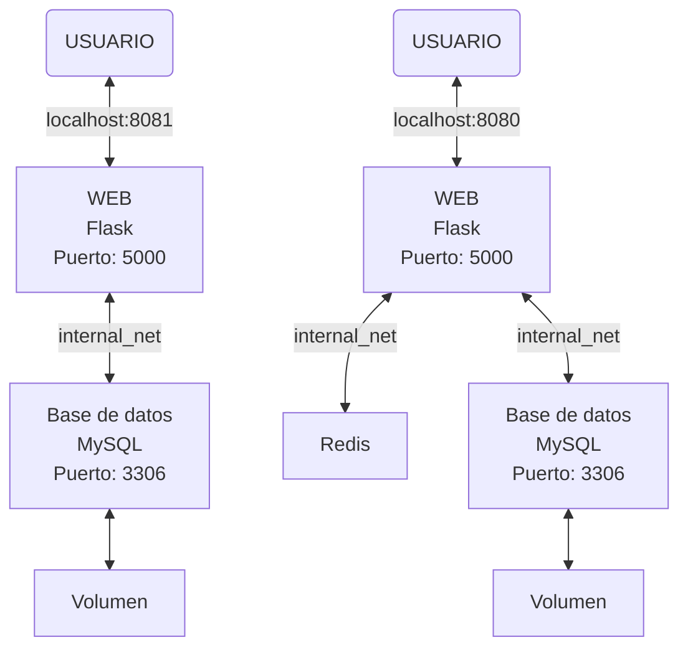

# Práctica 1 🐳 - Despliegue de aplicaciones multi-entorno

## Introducción

El objetivo de esta práctica es diseñar y desplegar una aplicación multicontenedor utilizando Docker Compose, simulando un entorno de despliegue real.

La arquitectura estará compuesta por una aplicación web, una base de datos y un servicio de caché, este último presente únicamente en el entorno de producción. Se configurarán dos entornos independientes, desarrollo (`dev`) y producción (`prod`), adaptando los servicios y sus configuraciones a las necesidades de cada uno.

A lo largo de la práctica se trabajarán conceptos fundamentales del ecosistema Docker, como la orquestación de contenedores, la gestión de variables de entorno, la persistencia de datos mediante volúmenes, la comunicación entre servicios a través de redes internas, las comprobaciones de estado (*healthchecks*) y la automatización de tareas mediante un *Makefile*.

El propósito final es obtener una infraestructura organizada, reproducible y fácil de gestionar, mediante el despliegue de aplicaciones con Docker Compose.

## Preparación para el proyecto

Antes de adentrarnos a generar archivos y documentos para la práctica, vamos a organizar qué utilizaremos. 

Seguiremos la siguiente estructura:

| Tecnología | Función |
| :--- | ---: |
| Python + Flask | Aplicación web y lógica del servidor |
| HTML, CSS y JavaScript | Interfaz de la página web |
| MySQL | Base de datos |
| Redis | Caché |
| Docker Compose | Orquestar los contenedores de la aplicación y los servicios|
| Makefile | Automatizar las operaciones habituales |

La organización de las carpetas quedará tal que así:

```
Practica1/
├── app/
│   ├── static/
|   |   ├── app.js
|   |   └── style.css
|   ├── templates/
│   |   └── index.html
│   ├── Dockerfile
│   ├── app.py
│   └── requirements.txt
├── db/
│   ├── images/
|   |   └── *.jpg   ;All .jpg images to have some fish data in sql database
│   └── init.sql
├── exampleImages/
|   └── *.jpg       ;All fish images to insert into the db through website to prove it's functioning
├── imagesP1/
|   └── *.jpg       ;All screenshots for the README.md
├── docker-compose.dev.yml
├── docker-compose.prod.yml
├── .env.dev
├── .env.prod
├── .gitignore
├── Makefile
└── README.md
```

Para el diseño de los entornos quedaría de la siguiente manera, siendo el esquema de la izquierda el entorno `dev` y el de la derecha el entorno `prod`:



## Diseño de la página web

Para esta práctica se ha decidido desarrollar **Aquarium**, una aplicación web para gestionar el inventario de peces de una tienda de animales especializada en acuariofilia.

La aplicación contará con una interfaz sencilla e intuitiva que permitirá consultar el catálogo, filtrar los peces disponibles y registrar nuevos ejemplares en el inventario. No se implementará un sistema de compras, ya que el objetivo principal es gestionar el *stock* y trabajar con la arquitectura de servicios propuesta en la práctica.

### Funcionalidades principales

#### 1 - Consulta del catálogo

La página principal mostrará los peces registrados mediante tarjetas informativas, incluyendo los siguientes datos:

- Nombre común y especie
- Tipo de agua y temperatura
- Precio
- Unidades disponibles en *stock*
- Una imagen

Aparte, se mostrará el número de especies en el catálogo, el número total de unidades en *stock* y el número de especies agotadas.

#### 2 - Filtrado de peces

Se podrán combinar diferentes filtros para localizar fácilmente los peces que cumplan los criterios seleccionados:

| Filtro | Opciones |
|---|---|
| Búsqueda | Escritura manual del nombre común o especie |
| Tipo de agua | Dulce o salada |
| Temperatura | Fría o cálida |
| Disponibilidad | En *stock* o agotado |

Por ejemplo, se podrán consultar únicamente los peces de agua dulce que vivan en aguas cálidas, que estén disponibles en *stock* y contengan en el nombre común o de la especie los caracteres 'an' en ese orden y en cualquier parte del nombre.

#### 3 - Registro de nuevos peces

La aplicación dispondrá de un formulario emergente (*pop-up*) para añadir nuevos ejemplares al inventario.

El formulario permitirá introducir la siguiente información:

- Nombre común
- Especie
- Tipo de agua
- Temperatura
- Precio
- Unidades en *stock*
- Descripción (opcional)
- Imagen (opcional)

Los campos correspondientes a categorías predefinidas se seleccionarán mediante desplegables, mientras que la especie se introducirá como texto libre.

#### 4 - Gestionar el incremento y decremento del stock y eliminación de fichas

Cada tarjeta incluye dos acciones diferenciadas:

- **Incrementar *stock* (+ 1 unidad):** aumenta el stock en una unidad cuando llega nuevo *stock*.

- **Incrementar *stock* (− 1 unidad):** reduce el stock en una unidad cuando un pez se vende, se pierde o muere. La ficha permanece en el catálogo y se marca como agotada cuando llega a cero.

- **Eliminar ficha:** elimina del catálogo el registro completo de esa especie. Esta acción se reserva para cuando se quiera retirar todo el producto del inventario, no para registrar la salida de una sola unidad.

#### 5 - Estado de los servicios

La cabecera está preparada para mostrar el estado real y actual de MySQL y Redis mediante el *endpoint* `/status`. Redis solo estará habilitado en producción; en desarrollo se indicará como no habilitado.

### Diseño de la interfaz

La interfaz se desarrollará utilizando **HTML, CSS y JavaScript**, con una distribución visual basada en tarjetas y filtros para facilitar la navegación y la gestión del inventario.

La siguiente imagen muestra el diseño final de la aplicación:

<p align="center">
  
</p>

### Integración con la arquitectura Docker

La aplicación web se implementará utilizando **Python y Flask** para gestionar la lógica del servidor y las comunicaciones con los servicios externos.

- **MySQL:** almacenará de forma persistente la información de los peces y su stock.
- **Redis:** se utilizará como caché únicamente en el entorno de producción, con el objetivo de reducir consultas repetidas y pesadas a la base de datos.

De este modo, Aquarium servirá como aplicación de ejemplo para poner en práctica la orquestación de contenedores, la persistencia de datos, la comunicación entre servicios y la gestión de entornos con Docker Compose.

## Implementación de MySQL

Vamos a conectar Aquarium con MySQL para que el catálogo deje de utilizar datos ficticios en el HTML y muestre los registros almacenados realmente en la base de datos. También he preparado las operaciones para que añadir peces, aumentar o reducir el stock y eliminar fichas persista en MySQL.

El cambio fundamental es que Flask consulta MySQL y proporciona los resultados al HTML mediante Jinja2.

El archivo `db/init.sql` crea la tabla y añade seis peces de ejemplo: guppy, pez payaso, pez globo, pez dorado, pez betta y neón chino. Así podremos probar la aplicación sin tener que introducir todos los registros manualmente. Cuando MySQL inicializa un volumen de datos vacío, la imagen oficial ejecuta los scripts de inicialización de `/docker-entrypoint-initdb.d`. Estos scripts se importan en la base de datos indicada por `MYSQL_DATABASE`.

Los datos de ejemplo se almacenan en MySQL: ya no son tarjetas ficticias escritas en el HTML.

## Creamos el Dockerfile de Flask

## Configuración del entorno de desarrollo (dev)

## Añadir Redis en producción

## Implementación

## Creación de Makefile para la automatización


Si hago [localhost/ ](http://localhost:8081/status).
Hacer un Make setup para que el profe esté contento.
Debemos saber en todo momento Como? Cuando? Es decir, que saber el pq en todo momento


