# Práctica 1 🐳 - Despliegue de aplicaciones multi-entorno

## Introducción

El objetivo de esta práctica es diseñar y desplegar una aplicación multicontenedor utilizando Docker Compose, simulando un entorno de despliegue real.

La arquitectura estará compuesta por una aplicación web, una base de datos y un servicio de caché, este último presente únicamente en el entorno de producción. Se configurarán dos entornos independientes, desarrollo (`dev`) y producción (`prod`), adaptando los servicios y sus configuraciones a las necesidades de cada uno.

A lo largo de la práctica se trabajarán conceptos fundamentales del ecosistema Docker, como la orquestación de contenedores, la gestión de variables de entorno, la persistencia de datos mediante volúmenes, la comunicación entre servicios a través de redes internas, las comprobaciones de estado (*healthchecks*) y la automatización de tareas mediante un *Makefile*.

El propósito final es obtener una infraestructura organizada, reproducible y fácil de gestionar, mediante el despliegue de aplicaciones con Docker Compose.

## Guía de instalación y ejecución paso a paso

Requisitos previos antes de ejecutar el proyecto, es necesario disponer de:

- Git, para descargar el proyecto.
- Docker, para ejecutar los contenedores.
- Docker Compose, integrado en las versiones actuales de Docker como docker compose.
- Make, para utilizar los comandos definidos en el Makefile.
- Los archivos del proyecto.

Primero de todo comprobamos que tienes descargado git con el comando `git --version`, si no lo tienes deberás descargarlo. Una vez que haya sido comprobado, podemos clonar el repositorio mediante el siguiente comando:

```
git clone git@github.com:ignasipc/Redes-Avanzadas.git
```

Con el repositorio descargado podemos acceder al trabajo actual cambiándonos al directorio correspondiente. Ejecutamos el siguiente comando:

```
cd Redes-Avanzadas/Practica1/
```

Ahora solo nos falta crear los archivos con las variables de entorno, `.env.dev` y `.env.prod`, que deben tener el siguiente formato (hay que cambiar 'XXXX' por valores adecuados, teniendo el puerto web diferente en cada archivo):

```
## =========================
# CONFIGURACIÓN WEB
# =========================
WEB_PORT_DEV=XXXX

# =========================
# CONFIGURACIÓN MYSQL
# =========================
MYSQL_PORT_DEV=3306

# Base de datos
MYSQL_DATABASE=XXXX

# Usuario root
MYSQL_ROOT_PASSWORD=XXXX

# Usuario
MYSQL_USER=XXXX
MYSQL_PASSWORD=XXXX

# =========================
# CONFIGURACIÓN REDIS (SOLAMENTE PARA .env.prod !!!)
# =========================
REDIS_PORT_PROD=6379
```

Una vez creados y configurados los archivos `.env.dev` y `.env.prod`, ejecutaremos `make setup`. Este objetivo comprueba los requisitos necesarios para trabajar con Docker, verifica la existencia de los archivos de configuración y valida que Docker Compose pueda interpretar ambos entornos. Si también incluye la construcción de las imágenes, esta operación se realizará durante la preparación del proyecto. El comando no instala automáticamente las herramientas que falten.

Puedes ejecutar el siguiente comando para saber si cumples con los cuatro primeros puntos anteriores:

``` 
git --version
docker --version
docker compose version
make --version
```

Una vez completadas estas comprobaciones, el proyecto estará preparado para iniciar los servicios. Si alguno de los requisitos no está instalado o la configuración contiene errores, será necesario corregirlos antes de continuar.

Para ejecutar, parar, eliminar, etc. puedes ejecutar los comandos make ya preparados. Consulta la [lista de comandos make](#lista-de-comandos-make) para conocer todas las operaciones disponibles.

Si simplemente quieres ejecutar el entorno `dev` o `prod` escribe simplemente en la terminal `make up-dev` o bien `make up-prod` y ejecuta el comando.

## Preparación del proyecto

Antes de adentrarnos a generar archivos y documentos para la práctica, vamos a organizar qué utilizaremos. 

Seguiremos la siguiente estructura:

| Tecnología | Función |
| :--- | ---: |
| Python + Flask | Aplicación web y lógica del servidor |
| HTML, CSS y JavaScript | Interfaz de la página web |
| MySQL | Base de datos |
| Redis | Caché |
| Docker Compose | Orquestación de contenedores y servicios |
| Makefile | Automatizar las operaciones habituales |

Crearemos una carpeta app donde tendremos todos los archivos acerca del HTML, CSS y JavaScript de la página Web, una carpeta db con todo lo necesario para la inicialización de nuestra Base de Datos, carpetas con imágenes para añadir ejemplos para hacer testeos y los archivos Docker Compose, los `.env.*` y el Makefile para las automatizaciones.

La organización de las carpetas quedará tal que así:

```
Practica1/
├── app/
│   ├── static/
|   |   ├── app.js
|   |   └── style.css
|   ├── templates/
│   |   └── index.html
│   ├── Dockerfile
│   ├── app.py
│   └── requirements.txt
├── db/
│   ├── images/
|   |   └── *.jpg   ;All .jpg images to have some fish data in sql database
│   └── init.sql
├── exampleImages/
|   └── *.jpg       ;All fish images to insert into the db through website to prove it's functioning
├── imagesP1/
|   └── *.jpg       ;All screenshots for the README.md
├── docker-compose.dev.yml
├── docker-compose.prod.yml
├── .env.dev
├── .env.prod
├── .gitignore
├── Makefile
└── README.md
```

Para el diseño de los entornos quedaría de la siguiente manera, siendo el esquema de la izquierda el entorno `dev` y el de la derecha el entorno `prod`:

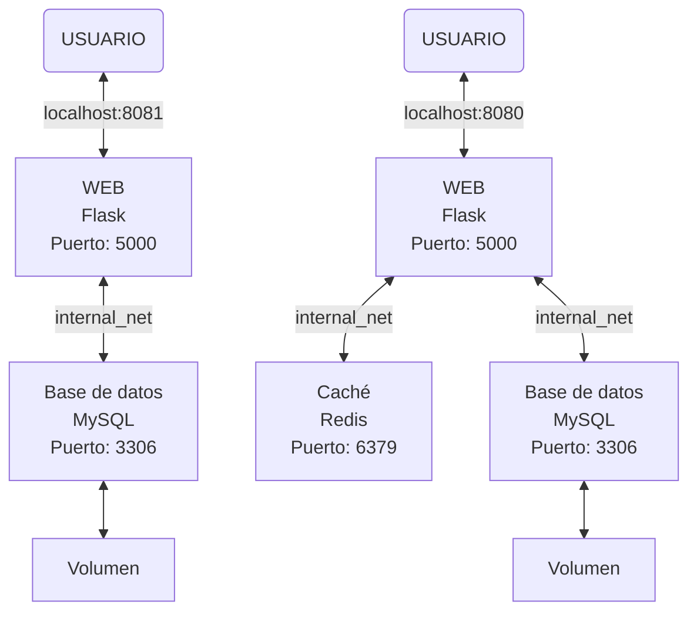

Una observación importante es que los servicios MySQL y Flask utilizan los mismos puertos internos en ambos entornos. Esto no genera conflictos porque cada entorno dispone de sus propios contenedores y de su propia red de Docker Compose. Además, los puertos publicados en el host pueden configurarse de forma independiente: por ejemplo, desarrollo puede utilizar el puerto 8081 y producción el 8080 para acceder a la aplicación web.

Los servicios MySQL y Redis no publican puertos en el host, por lo que se accede a ellos a través de la red interna de Docker. De este modo, los dos entornos mantienen sus servicios y sus volúmenes separados.

## Diseño de la página web

Para esta práctica se ha decidido desarrollar **Aquarium**, una aplicación web para gestionar el inventario de peces de una tienda de animales especializada en acuariofilia.

La aplicación contará con una interfaz sencilla e intuitiva que permitirá consultar el catálogo, filtrar los peces disponibles y registrar nuevos ejemplares en el inventario. No se implementará un sistema de compras, ya que el objetivo principal es gestionar el *stock* y trabajar con la arquitectura de servicios propuesta en la práctica.

### Funcionalidades principales

#### 1 - Consulta del catálogo

La página principal mostrará los peces registrados mediante tarjetas informativas, incluyendo los siguientes datos:

- Nombre común y especie
- Tipo de agua y temperatura
- Precio
- Unidades disponibles en *stock*
- Una imagen

Además, se mostrará el número de especies en el catálogo, el número total de unidades en *stock* y el número de especies agotadas.

#### 2 - Filtrado de peces

Se podrán combinar diferentes filtros para localizar fácilmente los peces que cumplan los criterios seleccionados:

| Filtro | Opciones |
|---|---|
| Búsqueda | Escritura manual del nombre común o especie |
| Tipo de agua | Dulce o salada |
| Temperatura | Fría o cálida |
| Disponibilidad | En *stock* o agotado |

Por ejemplo, se podrán consultar únicamente los peces de agua dulce que vivan en aguas cálidas, que estén disponibles en *stock* y contengan en el nombre común o de la especie los caracteres 'an' en ese orden y en cualquier parte del nombre.

#### 3 - Registro de nuevos peces

La aplicación dispondrá de un formulario emergente (*pop-up*) para añadir nuevos ejemplares al inventario.

El formulario permitirá introducir la siguiente información:

- Nombre común
- Especie
- Tipo de agua
- Temperatura
- Precio
- Unidades en *stock*
- Descripción (opcional)
- Imagen de máximo 5MB (opcional)

Los campos correspondientes a categorías predefinidas se seleccionarán mediante desplegables, mientras que los campos sin categorías predefinidas como la especie o el nombre común se introducirá como texto libre.

#### 4 - Gestionar el incremento y decremento del stock y eliminación de fichas

Cada tarjeta incluye tres acciones diferenciadas:

- **Incrementar *stock* (+ 1 unidad):** aumenta el stock en una unidad cuando llega nuevo *stock*.

- **Reducir *stock* (− 1 unidad):** reduce el stock en una unidad cuando un pez se vende, se pierde o muere. La ficha permanece en el catálogo y se marca como agotada cuando llega a cero.

- **Eliminar ficha:** elimina del catálogo el registro completo de esa especie. Esta acción se reserva para cuando se quiera retirar todo el producto del inventario, no para registrar la salida de una sola unidad.

Todos estos botones presentes en cada ficha de los peces, <u>al ser pulsados se deshabilitan hasta recibir una respuesta de Flask</u>. Tras una respuesta correcta, se vuelven a habilitar todos los botones.

#### 5 - Estado de los servicios

La cabecera está preparada para mostrar el estado real y actual de MySQL y Redis mediante el *endpoint* `/status`. Redis solo estará habilitado en producción; en desarrollo se indicará como no habilitado. El estado de los servicios se comprueban automáticamente en un intervalo de 10s gracias a una función dentro del `.js`.

La siguiente imagen muestra el diseño final de la aplicación:

<p align="center">
  
</p>

## Frontend - HTML, CSS y JavaScript

La interfaz de usuario de Aquarium se ha desarrollado utilizando HTML, CSS y JavaScript. Estas tres tecnologías trabajan conjuntamente para ofrecer una interfaz intuitiva, dinámica y accesible desde el navegador.

La función de cada uno es la siguiente:

- `HTML`: define la estructura y el contenido de la página web. Permite organizar los elementos de la interfaz, como las tarjetas de los peces, los filtros, los formularios y los botones de gestión del inventario.
- `CSS`: define la presentación visual de la aplicación. Se encarga de los colores, las tipografías, la distribución de las tarjetas, los formularios emergentes y la adaptación de la interfaz a diferentes tamaños de pantalla.
- `JavaScript`: añade interactividad a la página. Permite gestionar los filtros del catálogo, actualizar la interfaz, enviar peticiones HTTP a Flask y reaccionar a las respuestas del servidor sin necesidad de recargar toda la página.

El frontend se comunica con Flask mediante peticiones `HTTP`. De esta manera, las acciones realizadas por el usuario pueden modificar los datos almacenados en MySQL sin que el navegador tenga acceso directo a la base de datos.

Por ejemplo, cuando el usuario añade un pez, JavaScript recoge los datos del formulario y envía una petición `POST` a `/api/fish`. Flask valida la información, la guarda en MySQL y devuelve una respuesta **JSON** que permite actualizar la interfaz.

## Backend - Flask + Python

El backend se ha desarrollado con Python y Flask, un framework que permite implementar aplicaciones web mediante rutas `HTTP` y funciones asociadas a cada una de ellas.

Su responsabilidad principal es actuar como intermediario entre el frontend y los servicios de almacenamiento de MySQL.

Flask recibe las peticiones del navegador, valida los datos enviados, consulta o modifica MySQL, utiliza Redis cuando corresponde y devuelve una respuesta HTTP. El navegador no accede directamente a MySQL ni a Redis. Todas las operaciones pasan por Flask, que determina qué servicios debe utilizar en cada caso.

### Endpoint de estado `/status`

El endpoint `/status` permite consultar el estado de los servicios desde el navegador:

- `http://localhost:8081/status` para **DEV**.
- `http://localhost:8080/status` para **PROD**.

<p align="center">
  
</p>

Los puertos corresponden a la configuración definida en Docker Compose.

El endpoint ejecuta una consulta sencilla a MySQL (hace un `SELECT 1;`) y, cuando Redis está habilitado, realiza una comprobación mediante `ping`. La respuesta contiene información sobre el estado de los servicios, si la aplicación está en modo de solo lectura y si existe un catálogo disponible en caché para utilizar cuando MySQL no responde.

## Base de Datos - MySQL

MySQL es el sistema de gestión de bases de datos relacional utilizado para almacenar de forma persistente la información del inventario de Aquarium.

A diferencia de Redis, MySQL conserva los datos como fuente principal de información de la aplicación. Por tanto, las operaciones de creación, modificación y eliminación se realizan sobre esta base de datos.

### Estructura de los datos
El archivo `db/init.sql` define la estructura inicial de la base de datos y crea la tabla fish, donde se almacena la información de los peces.

Cada registro incluye los siguientes campos:

| Campo | Función |
|---|---|
| `id` | Identificador del pez |
| `name` | Nombre común |
| `species` | Nombre de la especie |
| `water_type` | Tipo de agua: dulce o salada |
| `temperature` | Preferencia de temperatura: fría o cálida |
| `price` | Precio del ejemplar |
| `stock` | Unidades disponibles |
| `description` | Descripción opcional |
| `image_data` | Contenido binario de la imagen, si existe |
| `image_mime_type` | Tipo MIME de la imagen |

### Persistencia mediante volúmenes Docker

Para evitar que los datos se pierdan al eliminar o recrear el contenedor de MySQL, se utiliza un volumen Docker. El volumen almacena los archivos de la base de datos fuera del ciclo de vida del contenedor. Mientras no se elimine el volumen, los datos pueden conservarse aunque se sustituya el contenedor que ejecuta MySQL.

## Caché - Redis

Redis se utiliza como sistema de caché únicamente en el entorno de producción (`prod`). En desarrollo (`dev`) no se despliega este servicio.

Su objetivo es reducir determinadas consultas a MySQL y permitir que parte de la información continúe disponible temporalmente cuando la base de datos no responde.

### Funcionamiento de la caché

Cuando Flask necesita una imagen, intenta obtenerla primero de Redis. Si la imagen no está almacenada en caché, consulta MySQL y, si la encuentra, puede guardarla en Redis para reutilizarla en futuras peticiones.

Si Redis no está disponible, la aplicación puede intentar obtener las imágenes directamente de MySQL, siempre que este servicio funcione correctamente.

Además, en producción se almacena una copia del catálogo en Redis. Si MySQL deja de estar disponible y existe una copia previamente guardada, Flask puede utilizar la información disponible en caché para mostrar el catálogo en modo de solo lectura.

La información que puede recuperarse depende de lo que se haya almacenado previamente. Por tanto, Redis no garantiza que todos los datos o imágenes estén disponibles cuando MySQL falla.

### Redis como complemento de MySQL

MySQL es la fuente principal de los datos persistentes. Redis almacena copias en caché para mejorar determinados accesos y facilitar la consulta de información cuando MySQL no responde.

Por este motivo, Redis no sustituye a MySQL: las operaciones que deban persistir cambios en el inventario requieren que MySQL esté disponible.

El funcionamiento de la caché de imágenes se resume en el siguiente diagrama:

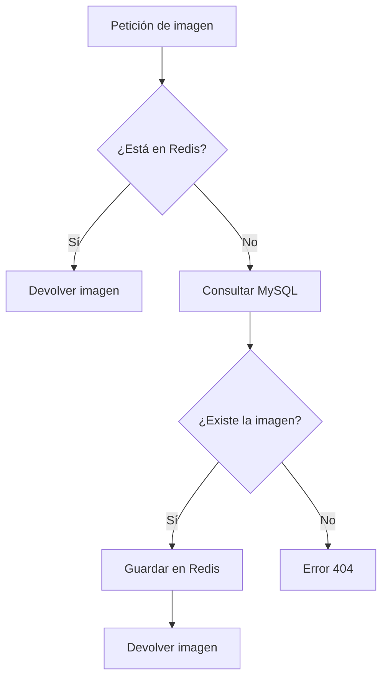

## Creación de Makefile para la automatización

Finalmente, para simplificar la gestión de los entornos de desarrollo y producción, se ha implementado un **Makefile** que automatiza las operaciones más habituales de Docker Compose, como iniciar, detener y eliminar los servicios, contenedores y recursos asociados a cada entorno.

Además, se ha incluido el comando `make setup`, cuyo objetivo es facilitar la preparación inicial del proyecto tras clonar el repositorio. De este modo, cualquier persona puede configurar el entorno de forma sencilla y reproducible, reduciendo la necesidad de realizar pasos manuales y facilitando tanto la modificación y ampliación de la aplicación como la comprobación de su correcto funcionamiento.

### Lista de comandos make:

| Comando | Operación |
|---|---|
| `setup` | Comprueba los requisitos del proyecto |
| `show-docker-status` | Muestra el estado general de los recursos de Docker (Ejecuciones, imágenes y volúmenes) |
| `up-dev` | Inicia el entorno de desarrollo |
| `up-prod` | Inicia el entorno de producción |
| `test-db-dev` | Comprueba que MySQL acepta conexiones TCP, que las credenciales son válidas, que el usuario puede acceder a la base de datos y que puede ejecutar una consulta SQL en el entorno de desarrollo |
| `test-db-prod` | Comprueba que MySQL acepta conexiones TCP, que las credenciales son válidas, que el usuario puede acceder a la base de datos y que puede ejecutar una consulta SQL en el entorno de producción |
| `down-dev` | Detiene y elimina los contenedores y redes de desarrollo |
| `down-prod` | Detiene y elimina los contenedores y redes de producción |
| `down` | Detiene y elimina los contenedores y redes de ambos entornos |
| `build` | Construye las imágenes de ambos entornos |
| `logs-dev` | Muestra los logs de desarrollo |
| `logs-prod` | Muestra los logs de producción |
| `ps-dev` | Muestra el estado de los servicios de desarrollo |
| `ps-prod` | Muestra el estado de los servicios de producción |
| `purge-all` | Detiene ambos entornos y elimina contenedores, redes, volúmenes e imágenes asociadas |

## Pruebas y verificaciones

El objetivo de estas pruebas es comprobar que la aplicación funciona correctamente en los entornos de desarrollo (`dev`) y producción (`prod`). Para ello, verificaremos el funcionamiento de la web, la conexión con MySQL, la persistencia de los datos, el uso de Redis como sistema de caché y el comportamiento de la aplicación cuando alguno de los servicios deja de estar disponible.

### Inicialización de los entornos

Comprobamos primero que los dos entornos se inician correctamente mediante los comandos `make up-dev` y `make up-prod`. A continuación, consultamos el estado de los contenedores para verificar que todos los servicios se encuentran operativos.

<p align="center">
  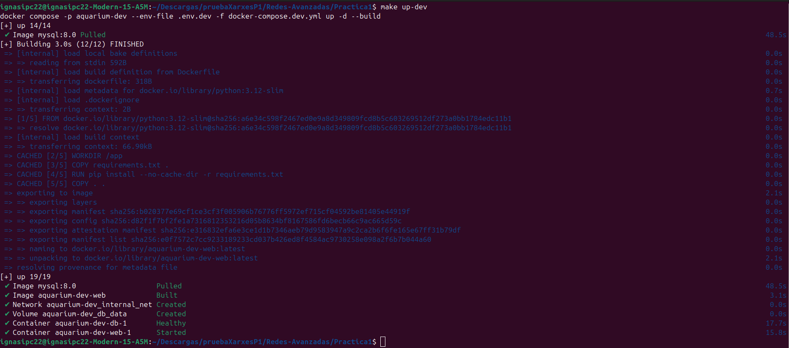
  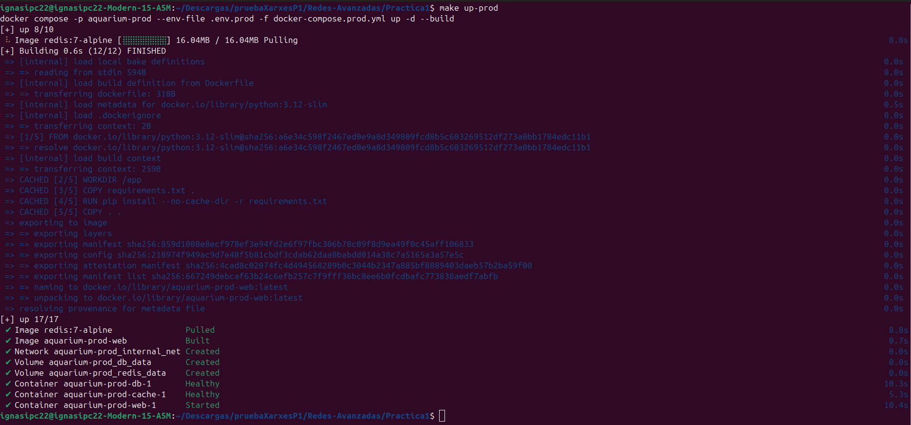
  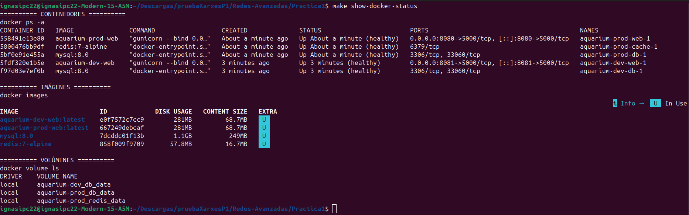
</p>

Como podemos observar, todos los servicios de los entornos `dev` y `prod` se inician correctamente y aparecen en estado `healthy`. En producción, este estado se aplica a los servicios `web`, `db` y `cache`, mientras que en desarrollo se aplica únicamente a `web` y `db`, ya que Redis no forma parte de este entorno.

### Comprobación del funcionamiento de la web

Para comprobar el funcionamiento de la interfaz, accedemos a la aplicación desde el navegador (según el puerto que se haya indicado en los `.env`):

- Desarrollo: `http://localhost:8081`
- Producción: `http://localhost:8080`

Una vez cargada la página, realizamos distintas operaciones para verificar el comportamiento del catálogo:

- Comprobamos que se muestran correctamente los peces, sus características y sus imágenes.
- Aplicamos los filtros disponibles para comprobar que permiten localizar los peces según el nombre, la especie, el tipo de agua, la temperatura y la disponibilidad.
- Modificamos el stock de los peces para comprobar que las operaciones de incremento y decremento funcionan correctamente.
- Añadimos un nuevo pez mediante el formulario, incluyendo una imagen, para verificar que se pueden introducir nuevos registros.

<p align="center">
  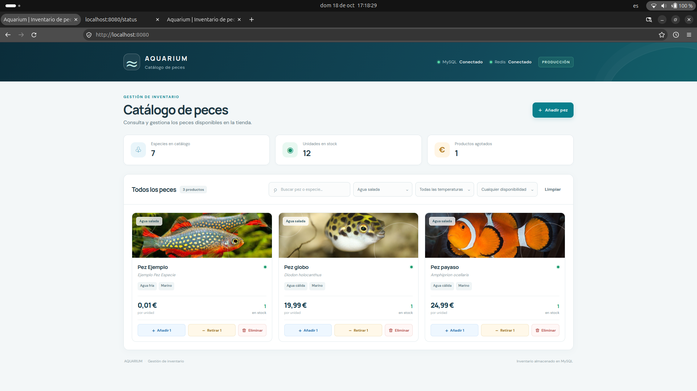
</p>

Como podemos observar, la aplicación permite consultar y filtrar el catálogo, modificar el stock y añadir nuevos peces. Las operaciones realizadas se reflejan en la interfaz correctamente.

Además, al recargar la página, los cambios guardados se mantienen, lo que indica que los datos se conservan en la base de datos y no dependen únicamente del estado temporal de la interfaz.

También comprobamos que los entornos de desarrollo y producción mantienen catálogos independientes. Los cambios realizados en uno de ellos no afectan al otro, ya que cada entorno utiliza su propia instancia de MySQL y sus propios volúmenes de datos.

### Comprobación del endpoint `/status`

Para verificar el estado de los servicios desde la propia aplicación, accedemos al endpoint `/status` de cada entorno:

- Desarrollo: `http://localhost:8081/status`
- Producción: `http://localhost:8080/status`

Este endpoint permite comprobar si las dependencias necesarias para el funcionamiento de la aplicación están disponibles. En desarrollo se comprueba la conexión con MySQL, mientras que en producción se comprueban tanto MySQL como Redis.

<p align="center">
  
</p>

Cuando todos los servicios necesarios están disponibles, el endpoint devuelve una respuesta JSON con información sobre su estado. En producción, un resultado como el siguiente indica que la aplicación se encuentra operativa:

### Comprobación de la conexión con MySQL

Para verificar que la aplicación puede conectarse correctamente con las bases de datos de ambos entornos, ejecutamos los comandos de prueba incluidos en el `Makefile`:

<p align="center">
  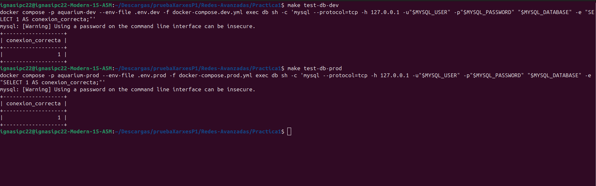
</p>

Estas pruebas comprueban la conectividad con MySQL, la autenticación mediante las credenciales configuradas y la ejecución de una consulta SQL.

Si ambos comandos finalizan correctamente, podemos confirmar que las bases de datos de desarrollo y producción responden a las pruebas de conexión realizadas.

### Comprobación de la persistencia de MySQL

Para comprobar que los datos se conservan correctamente, verificamos el comportamiento de la base de datos al detener y volver a iniciar el servicio MySQL.

En primer lugar, añadimos un pez desde la interfaz web y comprobamos que aparece en el catálogo:

<p align="center">
  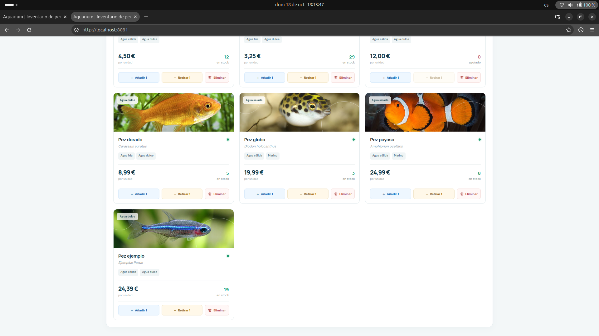
</p>

A continuación, eliminamos otro registro desde la aplicación y verificamos que desaparece de la interfaz.
Después, detenemos el servicio MySQL del entorno de desarrollo:

<p align="center">
  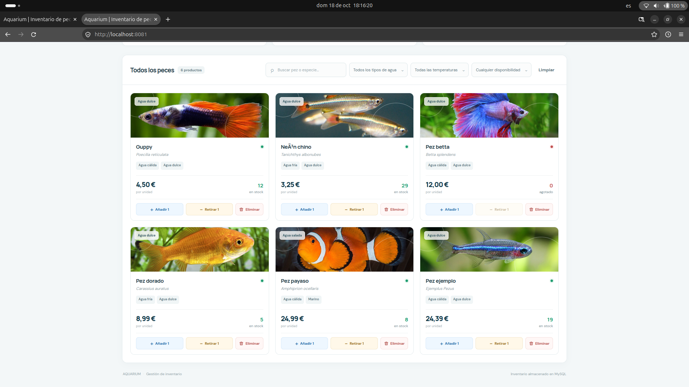
  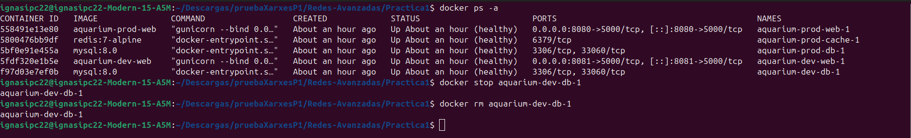
</p>

Mientras MySQL está detenido, intentamos acceder al catálogo y comprobamos cómo responde la aplicación ante la pérdida de conexión con la base de datos.

<p align="center">
  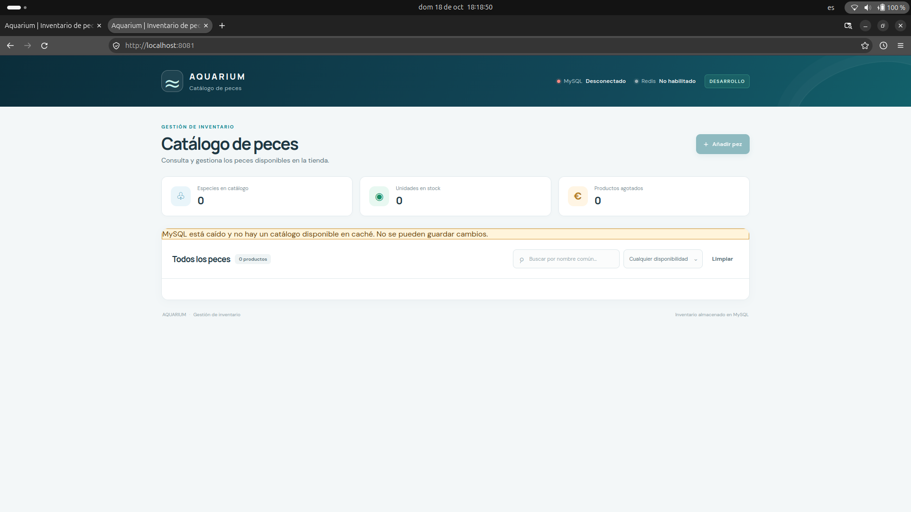
</p>

A continuación, volvemos a iniciar el servicio:

<p align="center">
  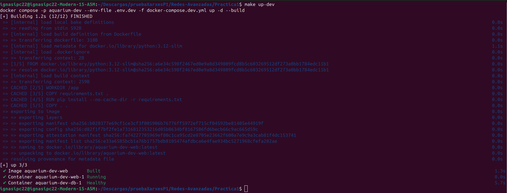
</p>

Una vez que MySQL vuelve a estar operativo, comprobamos nuevamente el catálogo y verificamos que los cambios realizados antes de detener el servicio se han conservado (Se han aplicado filtros para ver correctamente que se ha mantenido la inserción).

<p align="center">
  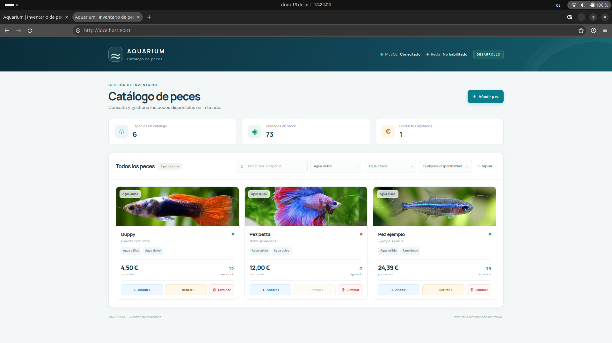
</p>

Este procedimiento permite comprobar que los datos persistentes se almacenan en el volumen de Docker asociado a MySQL. Detener e iniciar el contenedor no elimina dicho volumen, por lo que los datos no se pierden al reiniciar el servicio.

### Comprobación de la caché cuando MySQL deja de estar disponible

Para verificar el comportamiento de la aplicación ante una caída de MySQL, detenemos temporalmente el servicio en producción y a continuación, accedemos de nuevo a la web:

<p align="center">
  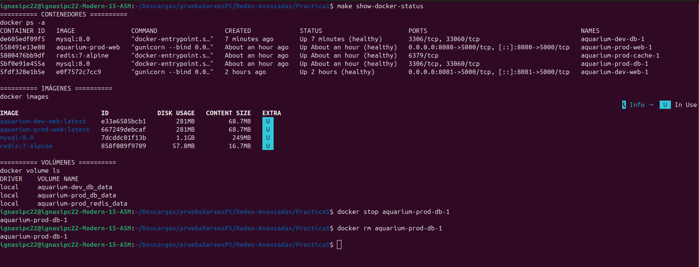
  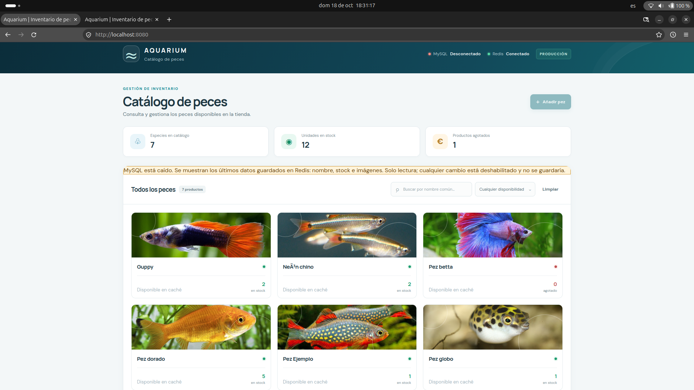
</p>

Comprobamos que la aplicación puede mostrar la información del catálogo que se encuentre almacenada previamente en Redis. Si existe una copia disponible y la implementación permite utilizarla, el catálogo podrá mostrarse en modo de solo lectura mientras MySQL permanezca desconectado.

Durante esta prueba también verificamos que las operaciones que requieren modificar los datos persistentes no se permiten cuando MySQL no está disponible.

Debemos tener en cuenta que la información disponible durante la caída depende de los datos que se hayan almacenado previamente en Redis. Por tanto, no se garantiza que todo el catálogo y todas las imágenes estén disponibles.

Finalmente, volvemos a iniciar MySQL:

<p align="center">
  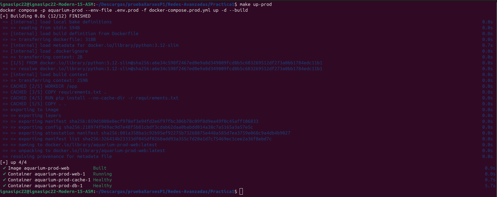
  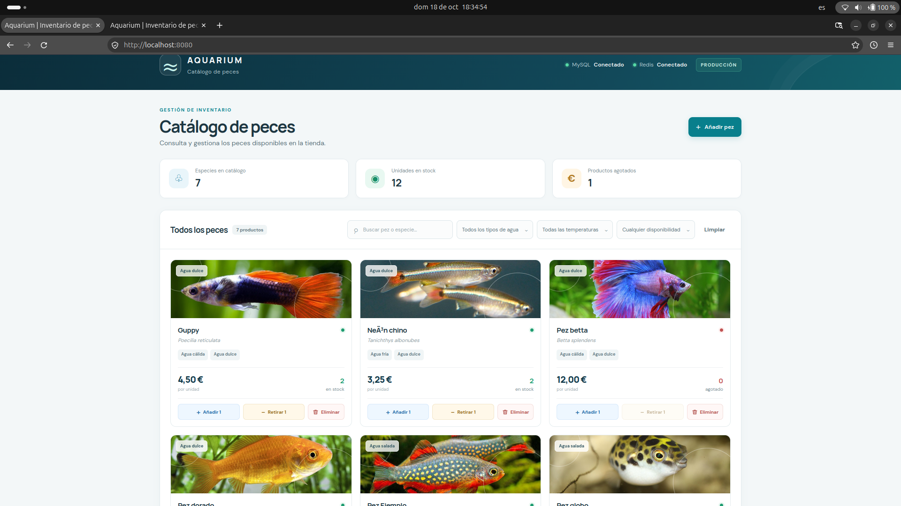
</p>

Con estas pruebas verificamos el funcionamiento básico de Redis como caché y comprobamos cómo responde la aplicación ante la pérdida temporal de conexión con MySQL.

## Explicación de los healthchecks

Los healthchecks de Docker permiten comprobar periódicamente si un contenedor está funcionando correctamente. No se limitan a comprobar que el contenedor esté encendido, sino que ejecutan una prueba para determinar si el servicio está operativo.

En este proyecto se utilizan para comprobar el estado de MySQL, Redis y Flask. Los tres tienen pruebas diferentes, adaptadas a cada servicio.

### Flask
```
healthcheck:
  test: ["CMD", "python", "-c", "import urllib.request; urllib.request.urlopen('http://127.0.0.1:5000/status', timeout=3).read()"]
  interval: 30s
  timeout: 5s
  retries: 3
  start_period: 10s
```
Este healthcheck comprueba la propia aplicación Flask mediante una petición HTTP al endpoint `/status`.

- `test`: utiliza Python para realizar una petición HTTP a `http://127.0.0.1:5000/status`.
- `interval: 30s`: comprueba la aplicación cada 30 segundos.
- `timeout: 5s`: establece un máximo de 5 segundos para la ejecución del healthcheck. La petición HTTP tiene, además, un tiempo de espera propio de 3 segundos.
- `retries: 3`: después de tres comprobaciones fallidas consecutivas, marca el contenedor como unhealthy.
- `start_period: 10s`: concede 10 segundos iniciales para que Flask arranque.

### MySQL
```
healthcheck:
  test: ["CMD-SHELL", "mysqladmin ping --protocol=tcp -h 127.0.0.1 -uroot -p\"$${MYSQL_ROOT_PASSWORD}\" --silent"]
  interval: 10s
  timeout: 5s
  retries: 12
  start_period: 30s
```
Este healthcheck utiliza el comando mysqladmin ping para comprobar si el servidor MySQL responde a través de TCP.

- `test`: ejecuta la prueba de disponibilidad de MySQL utilizando el usuario root y su contraseña.
- `interval: 10s`: realiza una comprobación cada 10 segundos.
- `timeout: 5s`: si la prueba tarda más de 5 segundos, se considera fallida.
- `retries: 12`: permite hasta 12 comprobaciones fallidas consecutivas antes de marcar el contenedor como unhealthy.
- `start_period: 30s`: concede 30 segundos iniciales para que MySQL se inicie sin contabilizar normalmente los fallos de arranque como definitivos.

### Redis
```
healthcheck:
  test: ["CMD", "redis-cli", "ping"]
  interval: 10s
  timeout: 3s
  retries: 5
  start_period: 5s
```
Este healthcheck ejecuta redis-cli ping, que comprueba si el servidor Redis responde.

- `test`: envía una petición PING a Redis. Si responde correctamente, devuelve PONG.
- `interval: 10s`: comprueba el servicio cada 10 segundos.
- `timeout: 3s`: establece un máximo de 3 segundos para completar la prueba.
- `retries: 5`: tras cinco comprobaciones fallidas consecutivas, marca el contenedor como unhealthy.
- `start_period: 5s`: concede un periodo inicial de 5 segundos para que Redis arranque.

## Declaración de uso de inteligencia artificial
- **Herramienta**: ChatGPT (OpenAI), modelo GPT-6.

- **Finalidad del uso**: Consulta de dudas técnicas, aclaración de conceptos relacionados con Docker, Docker Compose, Flask, MySQL y Redis, así como asistencia en la redacción y revisión de la documentación técnica además del código de los diferentes lenguajes utilizados.

- **Partes del trabajo en las que se ha aplicado**: Documentación del proyecto en el archivo README.md, explicación de la arquitectura de la aplicación y de los entornos de desarrollo y producción, configuración del Makefile y resolución de dudas sobre la conexión entre servicio, la persistencia de datos y en la creación de los archivos con los códigos de Docker Compose, Flask, MySQL y Redis.

La herramienta se ha utilizado como apoyo durante el desarrollo del proyecto. Las decisiones finales sobre la implementación y la integración de las soluciones propuestas corresponden al autor del trabajo.
